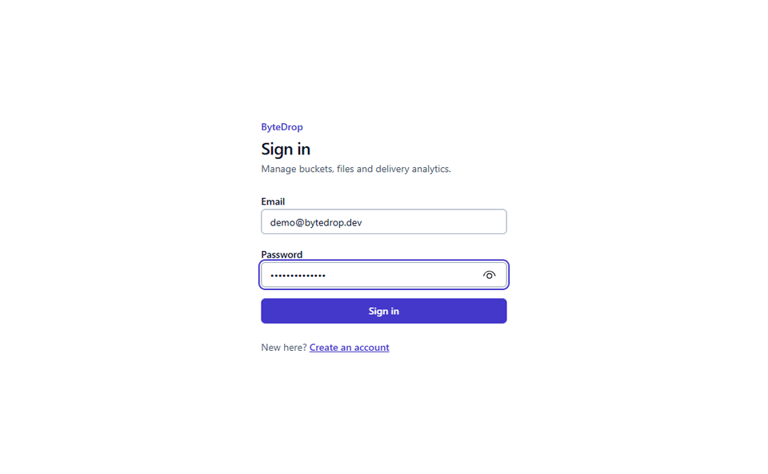
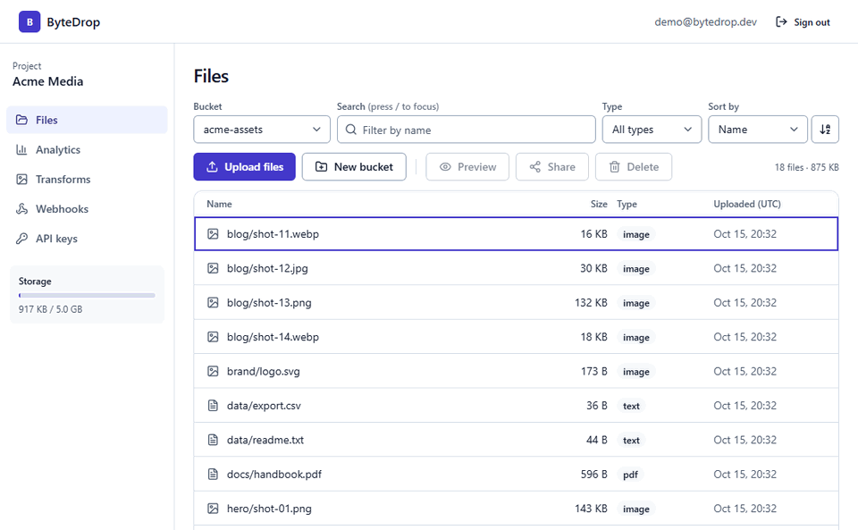
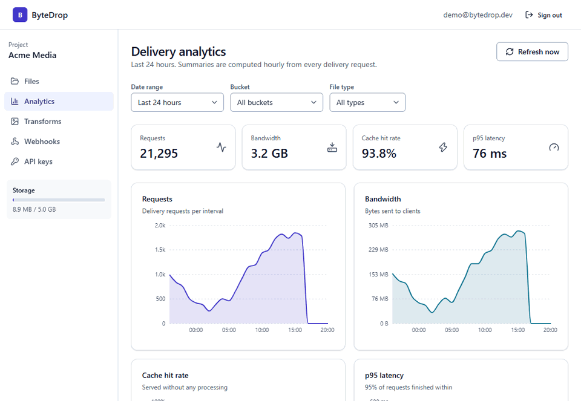
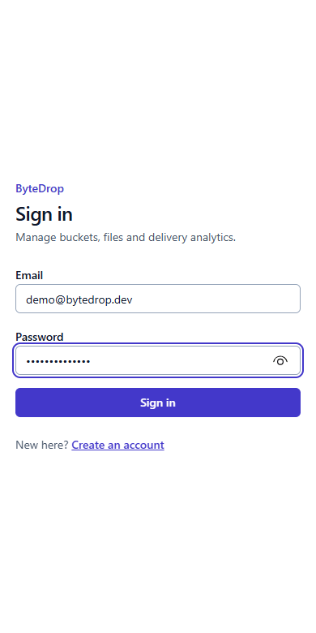
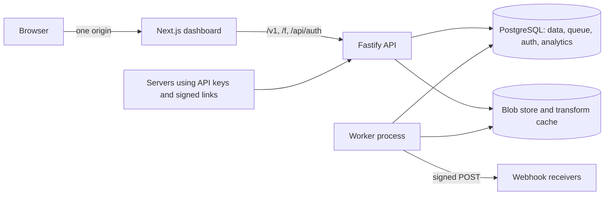

# ByteDrop

ByteDrop is a file storage and delivery service. You create a project, make buckets, upload files, and get fast, cacheable
links back. Images can be resized through the URL, changes are announced by webhook, and a dashboard shows how much
traffic everything gets.

It's a TypeScript monorepo: a Fastify API and background worker, a Next.js dashboard, and a shared package of schemas that
both sides use.

## Screenshots

**Browsing files, previewing an image and creating a signed link.** The file list is virtualised, so a bucket with
12,000 files renders only the rows on screen.



**Resumable uploads.** The file is hashed in a Web Worker and sent in chunks. Pause it, reload the page, and it carries on
from where the server left off.



**Delivery analytics and the image transform playground.**



**The same dashboard on a phone.**



## Features

### Storage and delivery

- Public and private buckets, with cursor-paginated listings
- Content-addressed storage: each file is stored once under its SHA-256, with reference counts and a garbage collector
- Resumable chunked uploads with per-chunk and whole-file hash checks
- CDN-style delivery: `ETag` / `If-None-Match` (304), `Range` requests (206), `Cache-Control`, `Content-Disposition`
- Signed, expiring links for private buckets
- On-the-fly image transforms (`?w=400&format=webp&q=80`) with an on-disk cache and request coalescing
- Per-key rate limits and per-project storage quotas

### Webhooks

- Events: `object.created`, `object.deleted`, `upload.failed`
- Each event is written to an outbox table in the same transaction as the change, then sent by the worker with an HMAC
  signature
- Exponential backoff with jitter, a delivery log, a replay button, and a per-endpoint circuit breaker

### Analytics

- Delivery events are buffered, written in batches and rolled up hourly
- Requests, bandwidth, cache hit rate, p95 latency, top files and top referrers, filterable by bucket, file type and date

### Dashboard

- Next.js App Router with server components for lists and analytics; filters live in the URL
- Virtualised file browser with search, sort and multi-select, all usable from the keyboard
- Upload queue with drag and drop, pause, resume, retry and cancel, persisted in IndexedDB
- Image, video, audio, PDF and text preview; share-link generator with an expiry picker
- Transform playground with before and after file sizes
- Recharts graphs for requests, bandwidth, cache hit rate and p95 latency
- Webhook endpoints and delivery log, API keys with one-time secrets
- Responsive layout, light and dark themes, a demo mode that runs on seeded data without a backend

## Architecture



- **PostgreSQL is the only stateful service.** It holds application data, sessions, the job queue (pg-boss), the webhook
  outbox and analytics.
- **Files sit behind a `StorageDriver` interface.** The included driver uses the local filesystem; another backend only
  needs to implement the same few methods.
- **The API and the worker are separate processes.** The worker handles thumbnails, garbage collection, analytics rollups
  and webhook delivery.
- **The dashboard proxies API calls**, so the browser only ever talks to one origin and sessions are plain first-party
  cookies.
- **Observability** is built in: structured logs with request ids, health and readiness endpoints, Prometheus metrics, and
  OpenTelemetry traces that follow a request into the queue job and the webhook it caused.
- **Docs** for the API are generated from the same Zod schemas that validate requests, and are served at `/docs`.

The reasoning behind the larger decisions is in [docs/adr](docs/adr/README.md). Operational notes are in
[RUNBOOK.md](RUNBOOK.md) and [POSTMORTEM-001.md](POSTMORTEM-001.md).

## Tech stack

| Area | Tools |
|------|-------|
| Language | TypeScript (strict) |
| Monorepo | pnpm workspaces, Turborepo |
| API | Node.js, Fastify, Zod, fastify-type-provider-zod, Scalar API reference |
| Database | PostgreSQL, Drizzle ORM and migrations |
| Queue | pg-boss |
| Images | sharp |
| Auth | Better Auth |
| Observability | pino, prom-client, OpenTelemetry |
| Dashboard | Next.js (App Router), React, Tailwind CSS, shadcn-style components, lucide icons |
| Client data | TanStack Query, React Hook Form, TanStack Virtual, Recharts |
| Browser features | Web Workers, IndexedDB, Mock Service Worker for demo mode |
| Testing | Vitest, Testing Library, Playwright, axe, Lighthouse CI |

## Repository layout

```
apps/api         Fastify API, worker, operator scripts
apps/web         Next.js dashboard and demo mode
packages/shared  Zod schemas and helpers used by both
docs             decision records and media
scripts          local tooling
load             k6 script
```
