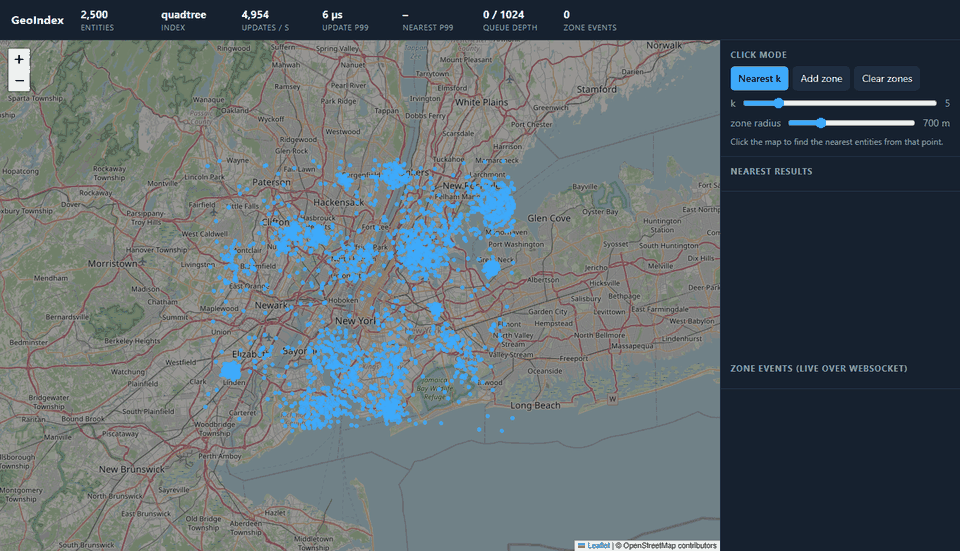
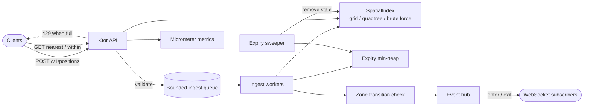
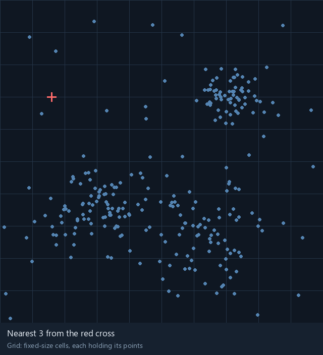
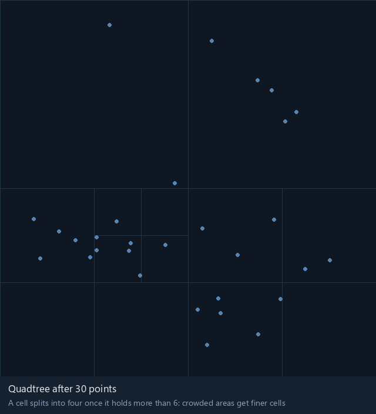
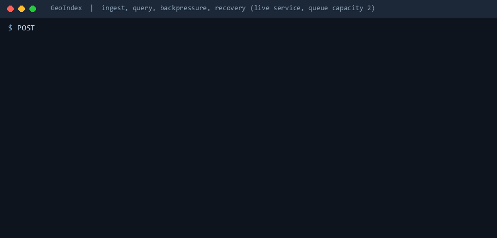

# GeoIndex

A real-time spatial index service. It ingests position updates for moving entities, answers "what is closest to here?" and "what is inside this circle?" in microseconds at a million points, expires entities that stop reporting, and pushes enter and exit events to subscribers over WebSockets.

## Objective

Marketplaces constantly ask which of many moving things is closest to a location. The naive answer scans every point, which is fine at a thousand points and unusable at a million. GeoIndex is a data structure and a service built to stay fast and stable as scale grows, with the measurements to prove it: three interchangeable index implementations compared honestly, a load generator that records latency without hiding stalls, microbenchmarks at 10 thousand, 100 thousand and 1 million points, and a profiler-driven fix.

At 1 million points, nearest-10 p99 goes from 70 ms with a full scan to 0.08 ms with the quadtree, and the profile of the mixed load led to a change that halved radius-query p99. The numbers, the method and the raw data are in [docs/performance.md](docs/performance.md).

## What it does

- **Ingests** position updates `(id, lat, lon, timestamp)` in batches over HTTP. Older reports for an id are ignored, so late or reordered batches cannot move an entity backwards.
- **Answers queries**: the nearest `k` entities to a point, and everything within a radius, both ordered by distance.
- **Expires** entities that stop reporting after a configurable silence.
- **Pushes live events** when an entity enters or leaves a circular zone, to WebSocket subscribers, optionally filtered to one zone.
- **Protects itself**: ingest goes through a bounded queue, and when it is full the service answers `429` with `Retry-After` instead of falling over.
- **Reports its own health**: update and query latency (p50, p95, p99), throughput, index size and queue depth, at `/metrics`, in Prometheus format at `/metrics/prometheus`, and as a periodic console line.
- **Ships a demo map** at `/` showing entities moving in real time, with click-to-query and click-to-draw zones.

The full endpoint reference is in [docs/api.md](docs/api.md).

## Architecture

### One interface, three indexes

All three implement `SpatialIndex` and return exactly the same results, ordered by distance and then id, so they can be compared on equal terms and the simplest one can act as the oracle for the others.

- **Brute force** scans every point. It is the baseline and the test oracle.
- **Grid** splits the map into fixed-size cells, each holding its points. A nearest query checks the cell the query falls in, then expands outward ring by ring, and stops as soon as no unscanned cell can contain a closer point than the current k-th best.

  

- **Quadtree** splits a cell into four when it holds too many points, so crowded areas get fine cells and empty areas stay coarse. Nearest search is best-first branch and bound: a priority queue ordered by distance to each cell or point, so most cells are never opened.

  

The grid is fastest on evenly spread data; the quadtree keeps leaf sizes bounded wherever the data clusters, which is what real city data does.

### Distance

At city scale a fast approximation replaces great-circle math. Coordinates are projected once to meters around the center of the covered area (equirectangular projection), and distance is plain Euclidean geometry on that plane. That is what lets the indexes prune with rectangle arithmetic. The error against haversine distance is bounded at 0.5% for boxes up to half a degree tall at latitudes up to 45 degrees, and a property test enforces that bound across the default area.

### Concurrency

The space is divided into stripes, each guarded by its own read-write lock (grid cells are grouped into stripes; the quadtree is rooted in a square array of tiles, one stripe per tile). Writers in different areas never block each other and readers of a stripe run in parallel. No thread ever holds two stripe locks, so there is no lock ordering to get wrong.

A move publishes the entity's new copy before retiring the old one, so a reader always sees at least one copy. The index tracks moves in flight so a reader can tell whether its scan overlapped one, and only then pays for duplicate removal. Reads are weakly consistent while writes are in flight and exact when they are not.

### Ingest, backpressure and expiry

Requests are validated (bounds, finite coordinates, timestamp window) and placed on a bounded queue of batches that a pool of workers drains into the index. A full queue means an immediate `429`; nothing blocks and nothing grows without limit. The recording below is a live service with a deliberately tiny queue: it ingests and answers queries, is flooded until it starts rejecting with `429` and `Retry-After`, then recovers once the queue drains.

Expiry uses a min-heap ordered by last-seen time. A re-report only updates the index; when an entity's heap entry comes due, the sweeper compares it with the entity's current timestamp and either re-queues it at the newer time or removes it. The heap therefore holds one entry per entity however often entities report, which is lazy deletion on re-report.

### Zones and live events

When an update is applied, the previous and new positions are checked against every zone and the difference becomes an `enter` or `exit` event. Expiry and deletion of an entity inside a zone raise an `exit` with a reason. Each WebSocket subscriber has a bounded buffer; a slow subscriber drops events (counted) rather than slowing ingest.

### Measurement harness

- **Load generator**: drives updates and queries at fixed rates, in process or over HTTP, with separate worker pools per operation. Operations are scheduled on a fixed timetable and latency is measured from the scheduled time, so stalls show up in the percentiles instead of being omitted. Latency is recorded with HdrHistogram.
- **JMH microbenchmarks**: nearest, radius and move for each index at 10 thousand, 100 thousand and 1 million points, plus a multi-threaded mixed read and write benchmark.
- **Java Flight Recorder**: a profile task and a summariser that lists the top CPU frames, the project methods that caused them, and allocation pressure.

### Data

Benchmarks and load tests run on a synthetic city: a fixed-seed mixture of Gaussian hot spots with a thin uniform background inside a city-sized box, with entities moving by random walk, at 10 thousand to 1 million points. Real coordinates (OpenStreetMap merchant exports, historic taxi pickups) can be loaded from CSV. [docs/performance.md](docs/performance.md) states which results come from which data.

## Tech stack

| Need | Tool |
| --- | --- |
| Language and build | Kotlin on OpenJDK 17+, Gradle |
| Service | Ktor (Netty) with WebSockets, kotlinx.serialization |
| Tests | JUnit 5, jqwik property tests, JaCoCo with an 85% coverage gate |
| Benchmarks and profiling | JMH, HdrHistogram, Java Flight Recorder |
| Metrics | Micrometer, printed to the console and served at `/metrics` |
| CI | GitHub Actions |
| Demo map | Leaflet with OpenStreetMap tiles |

Everything is free and runs with `./gradlew run`. There is no database, because the index lives in memory, and no containers. Build, test, benchmark and profiling commands are in [docs/development.md](docs/development.md).
