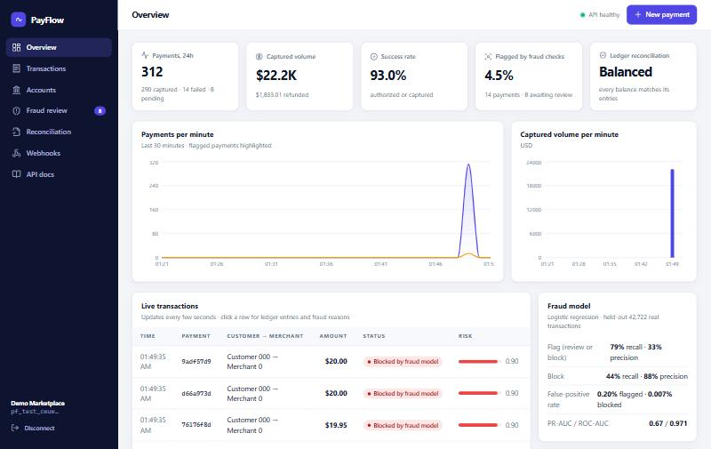
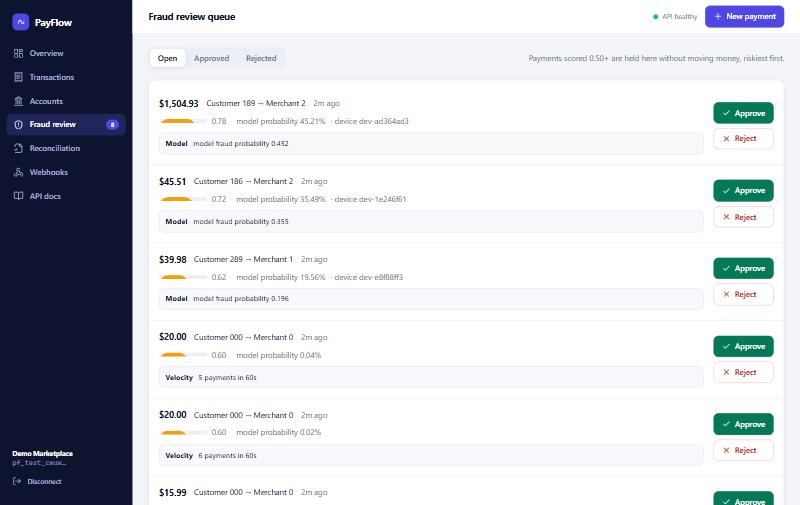
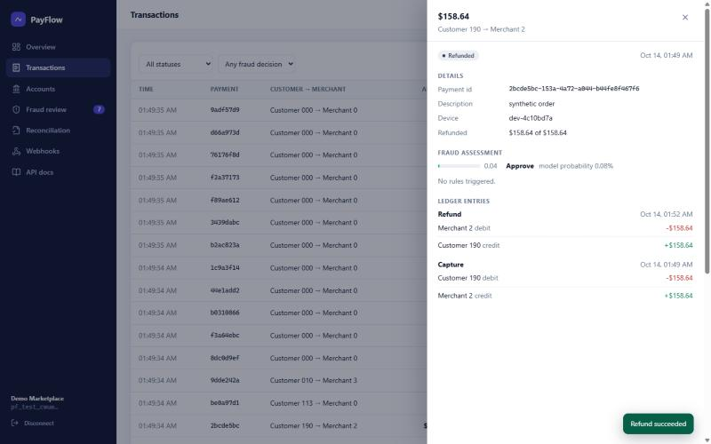
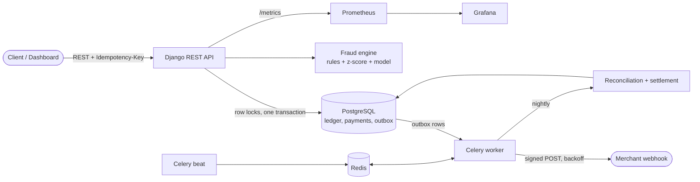

# PayFlow

A payments ledger and fraud-detection service that behaves the way a real payments backend does: every movement of money is recorded as balanced double-entry postings, a retried request never charges anyone twice, concurrent requests cannot overdraw an account, and every transaction is scored for fraud before it is approved.

Python 3.12 · Django + DRF · PostgreSQL · Celery + Redis · scikit-learn · React + TypeScript · Prometheus + Grafana · everything runs free and locally.



| | |
|---|---|
|  |  |

## What it does

| Area | Behaviour |
|---|---|
| **Double-entry ledger** | Accounts, transfers, refunds and balances are derived from immutable ledger entries. Each transaction's entries sum to zero. A nightly reconciliation job re-derives every balance and flags any mismatch. |
| **Idempotent payments API** | `POST /payments`, `/refunds`, deposits, capture and void require an `Idempotency-Key`. The same key is processed exactly once; the stored response is replayed on retries, including concurrent ones. Reusing a key with a different body is rejected. |
| **Payment state machine** | `pending → authorized → captured → refunded`, or `failed`. Invalid transitions return `409`. Authorization places a hold, capture releases it to the merchant, refunds can be partial and can never exceed the payment. |
| **Concurrency safety** | Row locks (`SELECT … FOR UPDATE`) taken in a fixed order, plus database constraints as a second line of defence. Proven by tests that fire hundreds of simultaneous requests. |
| **Async work** | Celery + Redis run webhook delivery, nightly reconciliation and settlement. |
| **Webhooks** | Transactional outbox, HMAC-signed (`PayFlow-Signature`), exponential backoff with jitter, dead-letter after 8 attempts, manual retry. |
| **Fraud scoring** | Real-time rules (velocity, large amount, new device, per-customer amount z-score) plus a logistic-regression model trained on the public ULB credit-card dataset. Risky payments are blocked or held in a manual review queue. |
| **Dashboard** | React/TypeScript: live transactions, balances, fraud review queue, reconciliation, webhooks. |
| **Observability** | Prometheus metrics (request rate, p95 latency, fraud-flag rate, webhook failures) and a provisioned Grafana dashboard. |
| **Quality** | 73 backend tests including property-based ledger invariants and concurrency tests (95% coverage, gate at 90%), 14 frontend tests, ruff, mypy, CodeQL, Docker builds and a full end-to-end job in CI. |

## Quick start (no Docker, no accounts, no cost)

Needs Python 3.11+ and Node 20+. This starts a real PostgreSQL 16 (from the `pgserver` wheel) and a Redis-compatible broker, runs migrations, and launches the API, a Celery worker and Celery beat.

```bash
cd backend
python -m venv .venv
.venv\Scripts\activate            # macOS/Linux: source .venv/bin/activate
pip install -r requirements-local.txt
python scripts/dev_up.py --seed   # prints an API key and writes frontend/.env.local
```

In a second terminal, the dashboard:

```bash
cd frontend
npm install
npm run dev                        # http://localhost:5173 (already signed in with the demo key)
```

API docs (Swagger UI) are at <http://127.0.0.1:8000/api/docs/>. To fill the dashboard with traffic, in a third terminal:

```bash
cd backend
python scripts/simulate_traffic.py --key <api key printed above> --payments 300 --resolve-reviews
```

### With Docker Compose

```bash
docker compose up --build
docker compose exec api python manage.py seed_demo --no-frontend-env   # prints an API key
```

Dashboard <http://localhost:8080> · API <http://localhost:8000/api/docs/> · Prometheus <http://localhost:9090> · Grafana <http://localhost:3000> (admin / admin). Postgres and Redis run as containers; no hosted services are involved.

## Using the API

Authenticate with `Authorization: Bearer <api key>`. Amounts are integers in minor units (cents). Full reference: `/api/docs/`.

```bash
KEY=pf_test_...
curl -s -X POST localhost:8000/api/v1/payments \
  -H "Authorization: Bearer $KEY" -H "Content-Type: application/json" \
  -H "Idempotency-Key: order-1042" \
  -d '{"payer_id": "<customer account>", "payee_id": "<merchant account>", "amount": 2599}'
```

Sending that request again, even simultaneously, returns the same payment with `Idempotent-Replayed: true` and charges nobody twice.

| Endpoint | Purpose |
|---|---|
| `POST /payments` · `GET /payments` · `GET /payments/{id}` | Create (auth + capture, or `"capture": false` to authorize only), list, fetch |
| `POST /payments/{id}/capture` · `/void` | Capture or release an authorization |
| `POST /refunds` | Full or partial refund |
| `GET /accounts/{id}/balance` | Balance computed from the account's ledger entries |
| `POST /accounts/{id}/deposit` · `GET/POST /accounts` | Fund and manage accounts |
| `GET /transactions` | Ledger transactions with their balanced entries (`?account=`, `?reference=`) |
| `GET /fraud/review-queue` · `POST /fraud/review/{payment}/resolve` | Manual review |
| `GET/PUT /webhooks/endpoint` · `GET /webhooks/deliveries` | Webhook configuration and delivery log |
| `POST /reconciliation/runs` · `POST /settlements/run` | Reconciliation and payouts (also scheduled nightly) |

Verifying a webhook on the receiving side:

```python
from webhooks.signing import verify_signature   # backend/webhooks/signing.py
ok = verify_signature(secret, request.headers["PayFlow-Signature"], request.body)
```

## Architecture



### Design notes

**The ledger is the source of truth.** `ledger_entry` is append-only (a database trigger rejects `UPDATE` and `DELETE`). Every `LedgerTransaction` must sum to zero, enforced by a deferred constraint trigger at commit, independent of application code. `Account.cached_balance` is a running total maintained under the same row lock; a `CHECK` constraint prevents it going negative, and reconciliation proves it equals the sum of the entries.

**Exactly-once payments.** The idempotency record is inserted in the same transaction as the payment. Its unique index serialises concurrent duplicates: the second `INSERT` blocks until the first commits, then replays the stored response. If the first transaction fails, the key is not consumed. Retries after a deadlock are safe for the same reason.

**No overdrafts, no deadlocks.** All account locks for a request are acquired in one batch, ordered by primary key, using `FOR NO KEY UPDATE` so they do not conflict with the foreign-key checks PostgreSQL runs at commit. Immediate-capture payments are a single payer→merchant transfer, so they never touch a shared "holds" row. Two bugs here (a commit-time deadlock against foreign-key checks, and an over-broad lock on the tenant row) were found by the traffic simulator, not by the unit tests; `test_mixed_concurrent_traffic_never_deadlocks` now reproduces them (it fails with `DeadlockDetected` on the old locking and passes on the fix).

**Transactional outbox for webhooks.** Events are written in the same transaction as the state change, then queued after commit. A sweeper re-queues anything whose task was lost, a lease prevents duplicate concurrent attempts, and `enqueued_at` stops the sweeper flooding the queue.

**Fraud decisions are explainable.** Every signal is mapped onto one 0-1 risk scale (0.5 = review, 0.8 = block); the score is the highest signal, and the reasons that fired are stored and shown in the dashboard.

## Fraud model

Trained on the public ULB credit-card fraud dataset: 284,807 real transactions, 492 frauds (see [`ml/data/README.md`](ml/data/README.md) for source and license). Reproduce with:

```bash
pip install -r ml/requirements.txt
python ml/download_data.py          # 144 MB, from a public mirror (the Kaggle original needs a login)
python ml/train_fraud_model.py
```

Chronological 70/15/15 split (fit on the past, tune on the next slice, report on the final slice). Thresholds are chosen on validation data by minimising expected cost: a blocked legitimate customer costs $10, a manual review $2, a missed fraud its full amount. Results on the **held-out** slice (42,722 transactions, 52 frauds):

| Policy | Precision | Recall | False-positive rate |
|---|---|---|---|
| Flag (review or block) | 32.8% | 78.8% | 0.197% |
| Block | 88.5% | 44.2% | 0.007% |

PR-AUC 0.67, ROC-AUC 0.97. Expected cost on the slice: $2,581, against $6,169 for approving everything. An isolation-forest baseline (PR-AUC 0.05) is reported alongside it. Full tables and the precision-recall curve are in [`ml/reports/fraud_model_report.md`](ml/reports/fraud_model_report.md).

Two honest caveats: the 52 test frauds make every rate uncertain by several points, and the dataset's features are anonymised PCA components, so the model is fed through an optional `risk_signals` field that an upstream signal provider would populate. The rules work without it.

## Testing

```bash
cd backend && pytest --cov            # needs the services from dev_up.py (or any PostgreSQL via DATABASE_URL)
cd frontend && npm test && npm run build
```

* **Ledger and API:** posting, overdraft rejection, database-level guarantees (unbalanced and mutated rows are refused), the full payment lifecycle, refunds, idempotency, tenant isolation.
* **Hypothesis property tests:** for any sequence of deposits, payments, captures, voids and refunds, every transaction balances, balances equal the sum of entries, nothing overdraws, refunds never exceed payments, and reconciliation agrees.
* **Concurrency:** 250 simultaneous payments against a balance that covers exactly 100 produce exactly 100 successes; 40 simultaneous requests with one idempotency key create one payment; 20 simultaneous refunds cannot exceed the payment; opposing transfers do not deadlock. Removing the row lock makes the first test fail, which was verified.
* **Fraud:** each rule, the review workflow, and the model scored against the real held-out transactions.
* **Webhooks:** signatures, backoff, dead-lettering, lease, outbox rollback, private-address rejection.
* **End to end:** `scripts/simulate_traffic.py` drives the running stack and exits non-zero if reconciliation fails, an idempotent replay differs, or a webhook signature does not verify. It replays *real* fraud rows from the held-out data as traffic, so the live precision and recall it prints can be compared with the offline evaluation. CI runs it against Postgres, Redis, gunicorn, a Celery worker and beat.

A representative run (300 payments, 20% of webhook calls failing on purpose):

```
captured 249 · failed: insufficient funds 8, blocked by fraud model 2 · in review 3 · two-step captures 38
velocity burst of 12 rapid payments from one customer: {'approve': 3, 'review': 5, 'block': 4}
idempotent replays that differed from the original: 0
webhooks: 633 delivered, 149 injected failures retried with backoff, 0 bad signatures, 0 dead
reconciliation: ok (311 accounts, 663 ledger transactions, 0 findings)
```

## Load test

`loadtest/locustfile.py` (Locust) models customers paying at a human pace, with retries and refunds, with the webhook path active. Measured on a laptop (Windows 11), with a **single-process** Python API server sharing the machine with PostgreSQL, the Celery worker, the broker and the load generator:

| Load | Throughput | `POST /payments` p50 / p95 | `GET balance` p95 | Errors |
|---|---|---|---|---|
| 6 users | 11 payments/s (19 req/s total) | 110 ms / 200 ms | 43 ms | 0 |
| 40 users (saturated) | 13 payments/s, requests queue | 1.7 s / 2.7 s | 1.1 s | 0 |

One payment costs about 65 ms of Python and 22 queries, so one process tops out near 15 payments/s here. The service scales by adding gunicorn workers (the Compose file runs 3); these numbers are a floor measured on a laptop, not a benchmark of a tuned deployment.

```bash
PAYFLOW_API_KEY=pf_test_... locust -f loadtest/locustfile.py --host http://127.0.0.1:8000 --headless -u 6 -r 6 -t 45s
```

## Repository layout

```
backend/     Django project: core (tenants, auth, idempotency), ledger, payments, fraud, webhooks, backoffice
  scripts/   dev_up.py (whole stack, no Docker), simulate_traffic.py, dev_services.py
frontend/    React + TypeScript dashboard (Vite, Recharts)
ml/          dataset download, training script, evaluation report, held-out sample
loadtest/    Locust scenario
monitoring/  Prometheus config and provisioned Grafana dashboard
```

CI lives in the repository root at `.github/workflows/payflow-ci.yml` and `payflow-codeql.yml` (this project sits in a multi-project repository, so both are path-filtered to `PayFlow/`).

## Deploying on free tiers

The code is written for this but it has not been deployed from this repository: hosting needs account sign-ups that are yours to make.

* **Database:** Neon free PostgreSQL. Set `DATABASE_URL` (include `?sslmode=require`).
* **Broker:** Upstash free Redis. Set `CELERY_BROKER_URL` to the `rediss://` URL.
* **API:** Render free web service from `backend/Dockerfile`. Set `DJANGO_SECRET_KEY`, `DJANGO_ALLOWED_HOSTS`, `CORS_ALLOWED_ORIGINS`, `RUN_MIGRATIONS=1`.
* **Worker and beat:** Render's free tier has no background workers, so run them in the API container (for example `celery -A payflow worker -B -c 2` started alongside gunicorn) or on any machine you already have.
* **Dashboard:** Vercel, root directory `frontend`, with `VITE_API_URL` set to the API origin.

Free instances sleep when idle, so the first request after a pause is slow.

## Known limitations

* The Docker Compose stack, Prometheus rules and Grafana dashboard are written and syntax-checked but were not run on the development machine (no Docker there); CI builds both images on every push.
* The no-Docker setup substitutes `fakeredis` for Redis. It is enough to exercise Celery end to end, but real Redis is what Compose and production use.
* One currency per account; no cross-currency transfers.
* A merchant whose webhook endpoint is down occupies worker slots until its deliveries time out. A per-endpoint queue or circuit breaker would be the next step.
* API keys are stored as SHA-256 hashes and the dashboard keeps the key in browser storage: fine for a demo, not for a multi-user product, which would add user sessions.
* The settlement job pays merchants out of the ledger; it does not connect to a real bank.

## Data and licenses

Fraud data: ULB credit-card fraud dataset, Database Contents License v1.0 (see `ml/data/README.md`). No real money, cards or personal data are involved; all customers, merchants and balances are synthetic.
