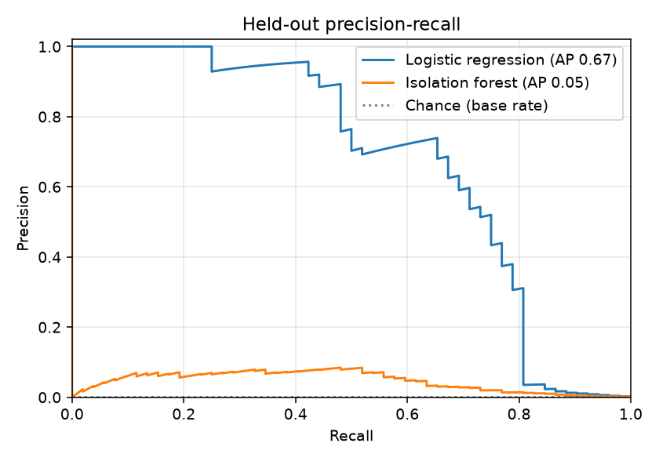

# Fraud model report

Public dataset: ULB credit-card fraud detection, 284,807 real transactions, 492 fraudulent.
Split: chronological 70/15/15 (train 199,364 / validation 42,721 / test 42,722, 52 frauds in test).
All numbers below are on the **held-out test slice**; thresholds were chosen on the validation slice only.

## Cost model

| Event | Cost |
|---|---|
| Legitimate customer blocked | $10.00 |
| Payment sent to manual review | $2.00 |
| Fraud that gets through | full transaction amount |

## Shipped model: logistic regression

PR-AUC 0.673, ROC-AUC 0.971.

| Policy | Threshold | Precision | Recall | False-positive rate | TP | FP | FN | TN |
|---|---|---|---|---|---|---|---|---|
| Flag (review or block) | 0.00998 | 0.328 | 0.788 | 0.197% | 41 | 84 | 11 | 42,586 |
| Block | 0.48814 | 0.885 | 0.442 | 0.007% | 23 | 3 | 29 | 42,667 |

Expected cost on the test slice: **$2,581**, against $6,169 for approving everything
and $426,700 for blocking everything.

## Baseline: isolation forest (unsupervised)

PR-AUC 0.047, ROC-AUC 0.935. Expected cost $4,426.

| Policy | Threshold | Precision | Recall | False-positive rate | TP | FP | FN | TN |
|---|---|---|---|---|---|---|---|---|
| Flag (review or block) | 0.55180 | 0.055 | 0.577 | 1.198% | 30 | 511 | 22 | 42,159 |
| Block | 0.74645 | 0.000 | 0.000 | 0.002% | 0 | 1 | 52 | 42,669 |

The supervised model wins clearly because labelled fraud is available; the isolation forest is kept as a
benchmark and as the starting point if labels were ever scarce.

## Caveats

* Features V1-V28 are anonymised PCA components, so the model is served behind an optional `risk_signals`
  field that an upstream signal provider would fill in. PayFlow's own rules (velocity, amount, z-score,
  new device) work without it.
* The data is two days of 2013 European card traffic with 0.17% fraud. Fraud patterns drift; a production
  system would retrain on a schedule and monitor precision/recall on fresh labels.
* The test slice contains only 52 frauds, so every rate above carries wide uncertainty
  (one fraud more or less moves recall by about two points).
* The cost figures are assumptions, not measurements. Change them in `ml/train_fraud_model.py` and re-run.
