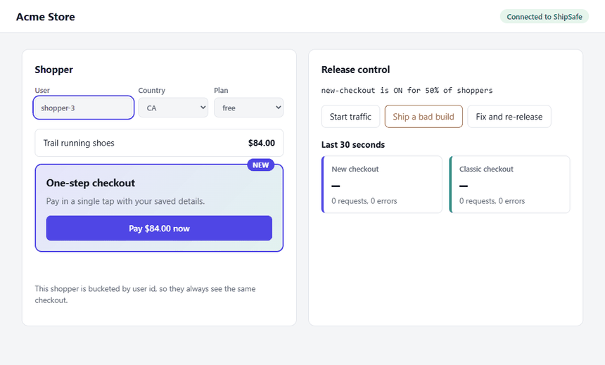
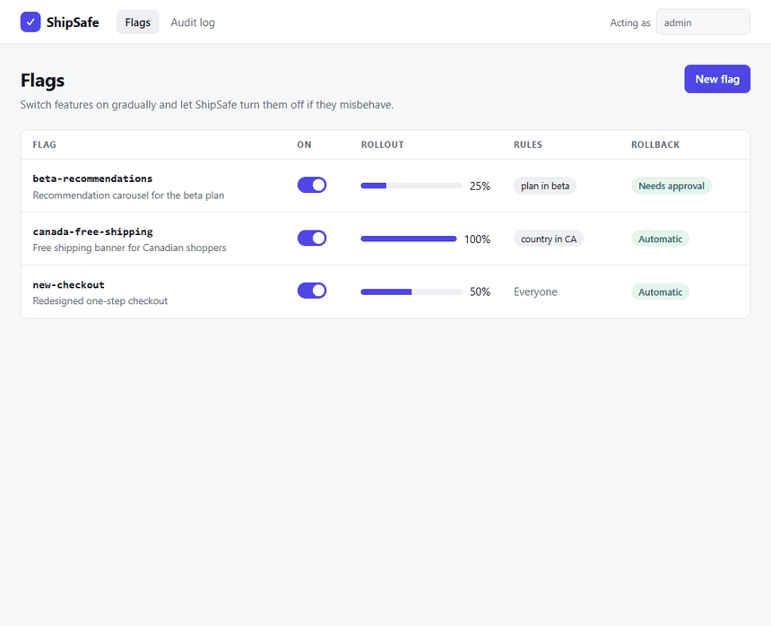
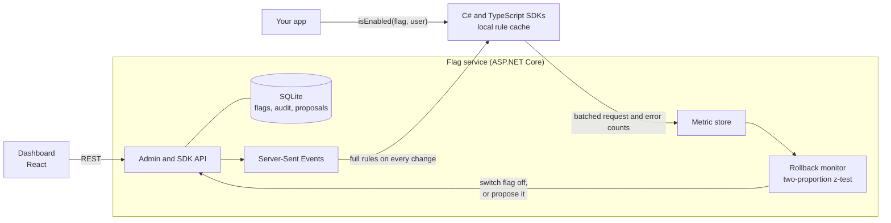

# ShipSafe

Feature flags with automatic rollback.

When a team ships a change to millions of users, it does not switch it on for everyone at once. A feature flag turns the new behavior on for 1% of users, then 10%, then everyone. If the new version starts failing, the flag is switched off straight away, with no redeploy. ShipSafe is a small, working version of that system: a flag service, SDKs for C# and TypeScript, a dashboard, and a guard that watches error rates and rolls a bad release back by itself.

## In action

A demo store runs a new checkout behind the `new-checkout` flag. Traffic starts, a bad build ships, ShipSafe notices the new version failing more than the old one, and the flag turns itself off. Shoppers on the new checkout land back on the classic one.

The same moment from the dashboard: error rates for each version, then the automatic rollback recorded in the activity log with the evidence behind it.

## What it does

- **Flags and rules.** An admin creates a flag such as `new-checkout` and sets rules: a rollout percentage ("5% of users"), targeting ("only users in Canada", "only the beta plan"), or both.
- **Consistent rollout.** The same user always lands in the same bucket, so nobody flips between old and new behavior from one request to the next. Raising a rollout never turns anyone off.
- **Local evaluation.** Apps ask "is `new-checkout` on for this user?" through the SDK. It evaluates against rules cached in memory, in tens of nanoseconds, so a million checks a minute do not become a million requests a minute.
- **Instant changes.** When an admin changes a flag, running apps receive it over a live stream within a second, without restarting.
- **Automatic rollback.** Apps report successes and errors for each flag. If users on the new version fail noticeably more than users on the old one, ShipSafe turns the flag off and records why.
- **Safe by design.** A minimum sample size and a minimum difference stop a handful of unlucky errors from causing a false rollback. A flag can instead require a person to approve the rollback.
- **Audit trail.** Every change, who made it, and when, including the statistics behind each automatic rollback.

## How it works

**Bucketing.** A user's bucket is `murmur3("flagKey:userId") mod 10000`. A user is in the rollout when their bucket is below `percent × 100`, after any targeting rules match. The C# and TypeScript SDKs share test vectors, so both give the same answer for the same user.

**Live updates.** The server holds every flag in memory and pushes the full rule set to each connected SDK over Server-Sent Events whenever anything changes. An SDK that loses its connection reconnects with backoff and receives the latest rules on arrival.

**Rollback decision.** Each SDK counts requests and errors per flag and per version (new or old), and sends them in small batches. For every flag the server compares the error rate of users on the new version with users on the old one over a sliding window, using a one-sided two-proportion z-test. It rolls back only when all of these hold:

1. Both versions have at least the minimum number of requests.
2. The p-value is below the flag's threshold.
3. The new version fails at least a minimum amount more often, so a tiny but statistically significant gap does not count.

Measurement restarts whenever a flag is edited, so a fixed release starts with a clean slate.

**Measured.** Evaluating a flag takes about 30 ns with a rollout rule and about 50 ns with two targeting rules, with no allocation. The server handles 500 requests per second on each SDK endpoint with a 99th percentile under 6 ms. In the simulated bad release, the flag is off about two seconds after the first failing request.

## Architecture

| Part | Responsibility |
| --- | --- |
| `ShipSafe.Core` | Bucketing, rule evaluation, the z-test and the rollback policy, shared by the server and the C# SDK |
| `ShipSafe.Server` | Flag API, audit log, live stream, metric store and the rollback monitor |
| `ShipSafe.Sdk` | C# client with a local rule cache, background refresh and batched reporting |
| `sdk/typescript` | The same client for browsers and Node |
| `dashboard` | Flag management, live release health and the audit log |
| `demo` | A small store whose checkout changes visibly with a flag |
| `tools/ShipSafe.Simulator` | Runs a simulated bad release and reports the time to rollback |

## Tech stack

| Area | Technology |
| --- | --- |
| Flag service | C#, ASP.NET Core (.NET 8), Entity Framework Core, SQLite |
| Live updates | Server-Sent Events |
| C# SDK | .NET class library |
| TypeScript SDK | npm package using `fetch` streaming |
| Dashboard | React, TypeScript, Vite, TanStack Query |
| Demo app | Node, TypeScript, the TypeScript SDK |
| Rollback logic | Two-proportion z-test on error rates, treatment versus control |
| Tests | xUnit, FsCheck property tests, Vitest, Playwright with axe |
| Performance | BenchmarkDotNet for SDK evaluation, NBomber for server load |
| Observability | Serilog, OpenTelemetry |
| CI | GitHub Actions with a coverage gate, CodeQL |
