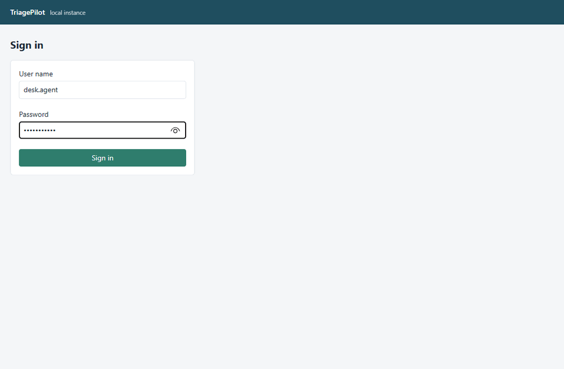
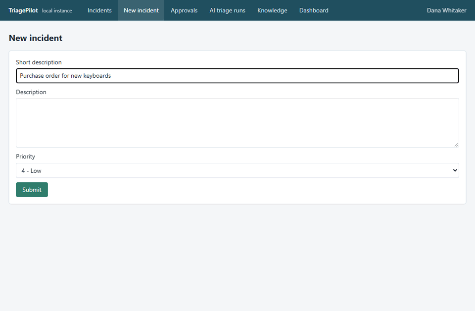
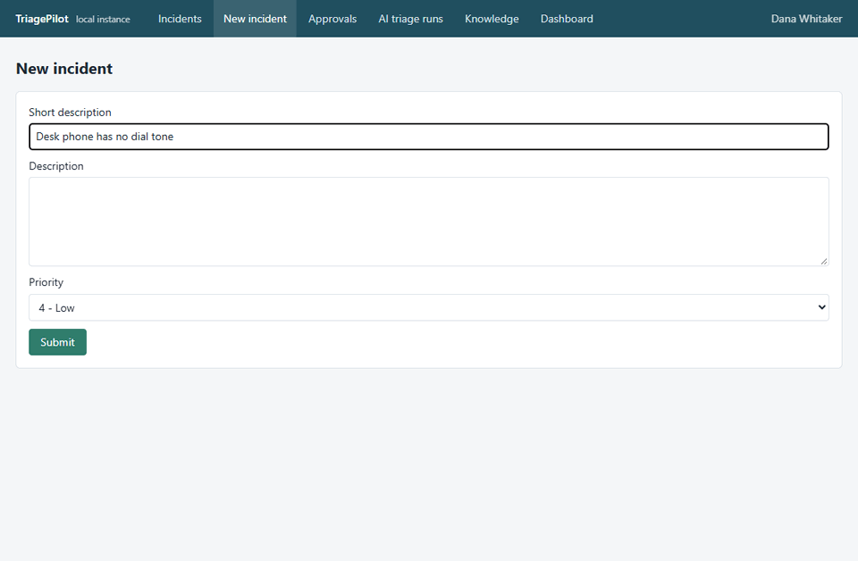
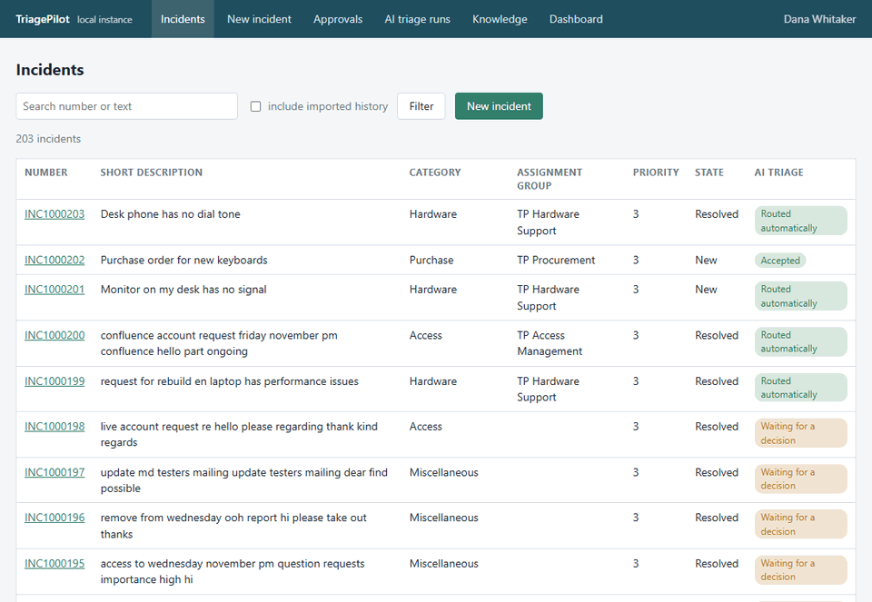
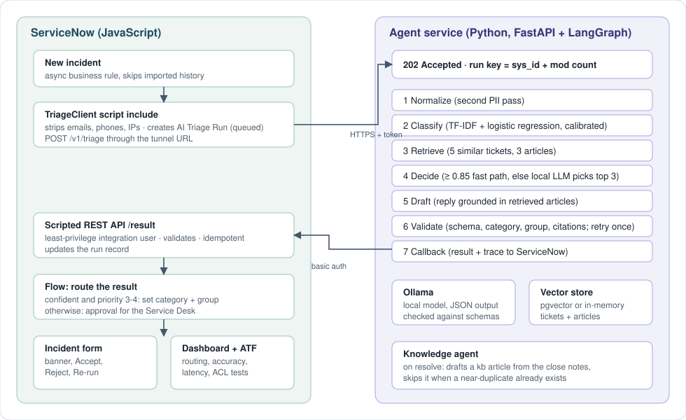

# TriagePilot

When someone files an IT ticket in ServiceNow, TriagePilot works out what kind of ticket it is, finds similar
old tickets and help articles, and writes a first reply. If it is sure, the ticket is routed on its own.
If it is not sure, a person approves it first. When the ticket is resolved, it writes a new help article
so the next ticket like it is easier to solve.

The aim was to route most tickets without a person, keep a person in the loop whenever the answer is
doubtful, and check all of that with numbers measured on real tickets.

## What it does

1. A new incident fires a business rule in ServiceNow. The ticket text is cleaned of email addresses,
   phone numbers and IP addresses, and a run record is created.
2. A Python service accepts the ticket straight away and works on it in the background. It never runs the
   same version of a ticket twice.
3. A classifier trained on about 38,000 real tickets picks one of eight categories and says how sure it is.
4. The service looks up the five most similar past tickets and the three best help articles.
5. If the classifier is at least 85% sure, that is the answer. If not, a small local language model chooses
   between the classifier's top three, using the similar tickets as evidence. It cannot invent a category.
6. The model drafts a reply that can only point to the articles that were found.
7. The answer is checked: valid category, real assignment group, every cited article was one of the retrieved
   ones, no personal data in the reply. A failed check is retried once, then handed to a person.
8. The result goes back to ServiceNow. A flow sets the category and group by itself when the confidence is
   high and the priority is not 1 or 2. Otherwise it creates an approval for the Service Desk.
9. On the incident form, a banner shows a pending suggestion with Accept, Reject (a reason is required) and
   Re-run buttons. Every decision is logged.
10. When an incident is resolved, a second agent drafts a knowledge article from the close notes, unless a
    near-duplicate already exists.

## Demo

**A confident ticket is routed on its own.** The category, the group and the reasoning are on the ticket
before anyone opens it.

**An unsure ticket waits for a person.** Reject needs a reason, Re-run asks the agent again, Accept applies the suggestion.

**Resolving a ticket drafts a help article.**

**The dashboard.**

## How it was built

**Data.** The tickets come from the public IT Service Ticket Classification dataset (about 47,800 tickets, eight
categories, CC0). I split it 80/20 with the same category mix in both parts. The text in this dataset has already
had stop words removed and words reduced to their base form, so incoming tickets are put through the same
cleaning before they reach the classifier. About 3,000 of the training tickets are loaded into ServiceNow as resolved
history with an import set and a transform map; all 47,800 are embedded for similarity search.

**Classifier.** TF-IDF features with logistic regression, with calibrated probabilities so that "85% sure"
means something. Macro-F1 is the main score because Hardware is far bigger than the other classes.

**Agent.** FastAPI with strict Pydantic models. The workflow is a LangGraph graph with a fixed order of steps
(clean, classify, retrieve, decide, draft, validate, send back) and not free-form tool use. Small local models are
much more reliable when each step is narrow and its output is checked. The language model runs on Ollama, on the
same machine, and answers in JSON that has to match a schema.

**ServiceNow.** The app is plain JavaScript: business rules, script includes, a scoped REST API, a flow with an
approval, a client script and UI actions on the incident form, ACLs, a dashboard and ATF tests. Everything the
agent receives is authenticated as an integration user that can do nothing else.

**Testing.** A small local instance runs the same ServiceNow scripts (GlideRecord, business rules, flows, ACLs,
scripted REST, the incident form with its client script). The agent talks to it over the Table API and REST
endpoints, the same ones a developer instance exposes. The agent has 54 tests, the ServiceNow scripts have 25 tests
plus 5 ATF-style tests, and model answers are recorded so the tests give the same result every time.

## Results

Measured on real tickets the model never saw. Macro-F1 is the main score because the classes are uneven.

| Test | Classifier | LLM alone (no training) | Hybrid |
|---|---|---|---|
| 799 held-out tickets, macro-F1 | **0.847** | 0.561 | 0.828 |
| 40 hand-written tickets, macro-F1 | 0.923 | 0.923 | **1.000** |

- The classifier alone scores 86.0% accuracy and 0.862 macro-F1 on all 9,568 held-out tickets.
- When the classifier is at least 85% sure (45% of tickets), it is right 98.5% of the time.
- On the held-out dataset tickets the hybrid does a little worse than the classifier alone. On the 482 unsure
  tickets the classifier is right 73.7% of the time and the hybrid 70.1%. The dataset text is stripped to keywords,
  which gives the language model little to read. On natural sentences the hybrid helped (11 unsure tickets, all fixed).
  The hand-written set is small, and I wrote it after reading what each category means in the data, so treat it as a sanity check.
- Live replay of 200 held-out tickets through ServiceNow and the agent, one at a time: 0 failed runs,
  0 replies citing an article that was not retrieved (the validator stepped in on 3 runs), 41.5% routed
  automatically at 97.6% accuracy, the rest sent to a person for approval, median run 6.3 s and p95 8.8 s on a laptop GPU.

At the 85% threshold, fewer than half of the tickets are routed without a person. Lowering the threshold routes more
but costs accuracy (see `docs/evaluation.md`). Full numbers are in `eval/`.

## Architecture

## Tech stack

| Part | Used |
|---|---|
| ServiceNow side | JavaScript: business rules, script includes, scoped REST API, Flow Designer with approvals, client scripts, UI actions, import sets and transform maps, ACLs, reports and dashboard, ATF |
| Agent service | Python 3.11, FastAPI, Pydantic v2, LangGraph, httpx, tenacity |
| Classifier | scikit-learn: TF-IDF and calibrated logistic regression |
| Similarity search | sentence-transformers (`all-MiniLM-L6-v2`), pgvector or an in-memory store |
| Language model | Ollama running `qwen2.5:7b` locally |
| Tests | pytest, respx, Node's test runner, recorded model answers |
| Delivery | Docker Compose, GitHub Actions |
| Cost | Nothing. Everything runs locally, with no paid service and no card |
