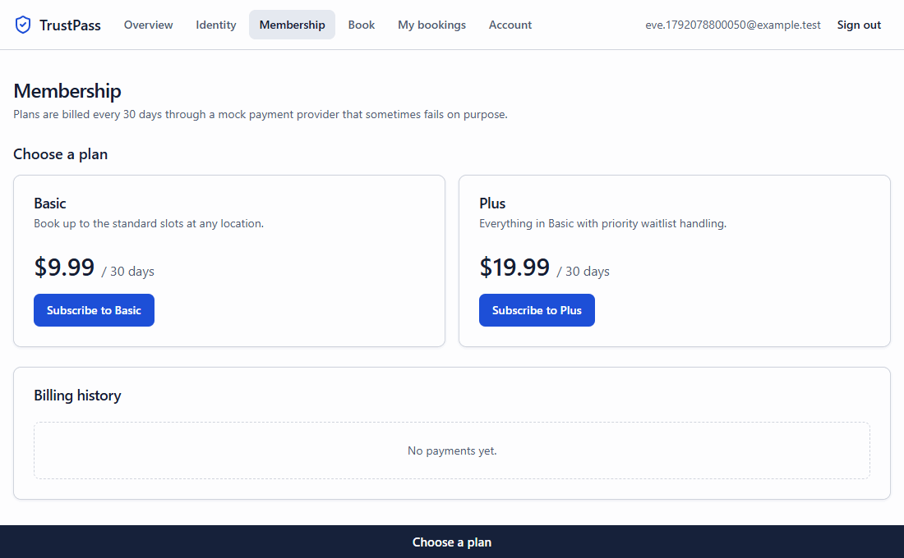
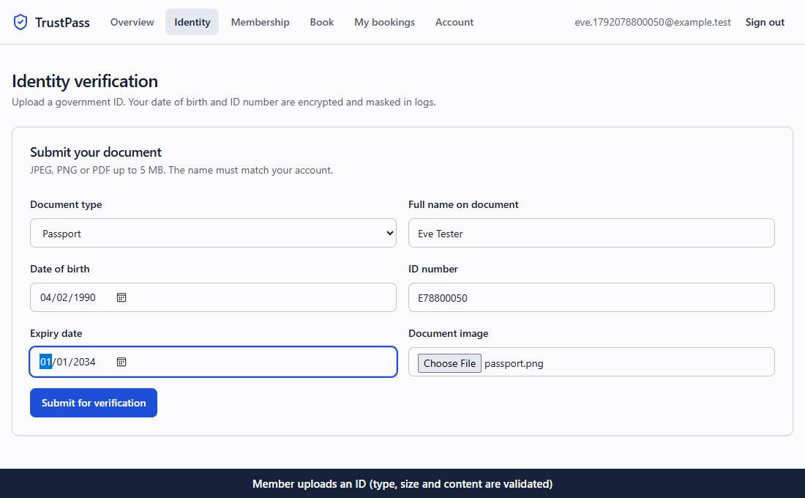
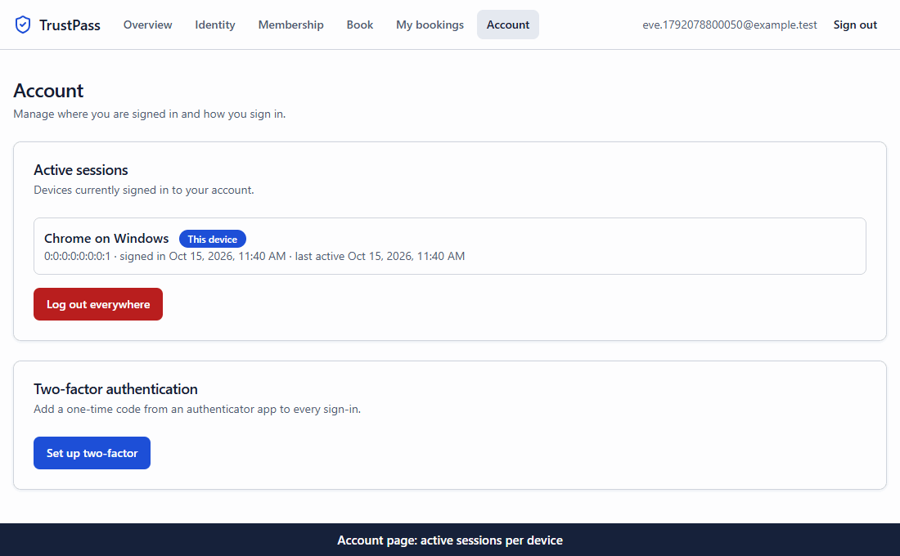
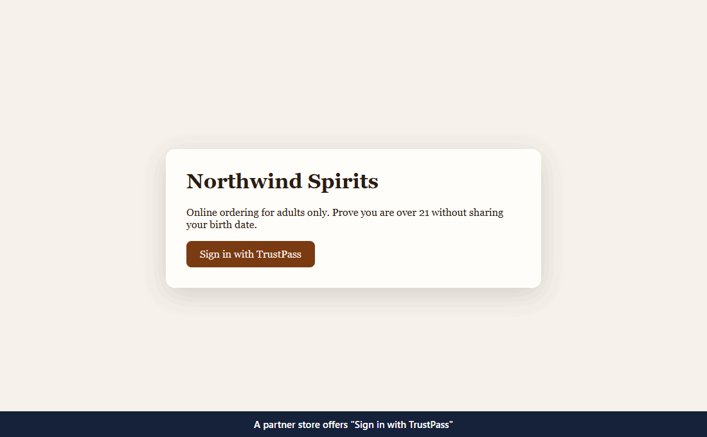
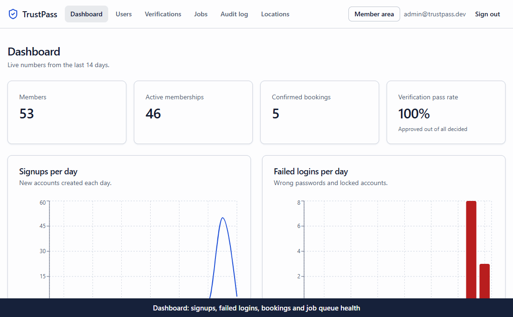

# TrustPass

TrustPass is a member identity and booking platform. People enroll, verify who they are, buy a membership and book time slots. Staff review identity documents and handle support from an admin console. Partner apps can offer "Sign in with TrustPass" and receive a yes/no answer to "is this person a verified adult over 21?" without ever seeing a date of birth.

It is a full-stack Java, React and TypeScript project that runs entirely on a laptop: no Docker, no cloud account and no paid service.

## What it does

- **Enrollment and login:** sign up with a password policy, verify the email with a one-time link, sign in with short-lived tokens, two-factor codes, lockout and rate limits, and manage active sessions per device.
- **Sign in with GitHub or Google:** a verified provider email that matches an existing account must be confirmed with the account password before the two are linked.
- **Identity verification:** upload a government ID, run automated checks in a background worker, and move it through a reviewer queue (`PENDING → IN_REVIEW → VERIFIED / REJECTED`).
- **Membership and billing:** Basic and Plus plans with subscribe, renew, cancel and billing history against a mock payment provider that fails on purpose.
- **Booking:** locations and time slots with a capacity, bookings, cancellations and a waitlist that promotes the next person automatically.
- **Staff console:** four roles, an append-only audit log, a metrics dashboard, user management and a dead-job screen with a Retry button.
- **Sign in with TrustPass:** TrustPass is an OpenID Connect provider. A demo partner app signs users in with Authorization Code and PKCE and receives only `verified_age_over_21`.

## Demos

### Sign up, email verification and sign in


### Membership payment and booking


### Identity verification and reviewer approval


### Two-factor authentication and sessions


### Sign in with TrustPass on a partner app


### Staff console


## What was built and how

Each item reads: accomplished X, measured by Y, by doing Z.

**Authentication and sessions**
- Protected accounts from credential attacks, measured by 22 auth and two-factor tests passing, by hashing passwords with Argon2, enforcing a password policy, and storing only a SHA-256 hash of the email verification token (24-hour expiry, single use).
- Stopped stolen refresh tokens from being reused, measured by a test where replaying a used token returns 401 and revokes every session of that user, by issuing 15-minute JWT access tokens and 7-day refresh tokens in an `httpOnly` cookie that rotate on every use. Each access token carries a session id checked on every request, so logging out takes effect immediately.
- Blocked brute-force attempts, measured by tests for lockout on the 5th failure (HTTP 423) and rate limiting (HTTP 429), by combining account lockout with Bucket4j limits per IP and per email stored in PostgreSQL.
- Added two-factor login, measured by tests for TOTP codes, single-use backup codes and wrong-code rejection, by implementing TOTP with QR setup, eight hashed backup codes and an encrypted secret.
- Avoided account enumeration, measured by tests that unknown emails, wrong passwords and duplicate signups look identical to the client, by using uniform responses and a timing decoy hash.
- Linked OAuth identities safely, measured by 6 account-resolution tests, by using Spring Security OAuth2 Client and requiring a password confirmation before a provider is attached to an existing account.

**Identity verification**
- Kept sensitive data unreadable at rest, measured by tests that stored values never contain the plain date of birth or ID number, by encrypting them (and the TOTP secret) with AES-GCM through a JPA attribute converter and masking the ID number for reviewers.
- Detected the same ID reused across accounts without comparing plain values, measured by a worker integration test, by storing a keyed HMAC fingerprint of the ID number and a SHA-256 hash of the file.
- Hardened uploads, measured by tests for wrong type (415), oversize (413) and valid JPEG, PNG and PDF files, by validating magic bytes, capping size at 5 MB and storing files behind a `StorageService` interface with path-traversal protection.
- Enforced the review workflow, measured by tests for invalid transitions (409), required rejection reasons (400) and two simultaneous reviewers where exactly one wins, by modelling a state machine and locking the row on decision.
- Automated first-pass review, measured by unit and integration tests, by running a worker job that flags expired documents, name mismatches, under-18 applicants and duplicates.

**Billing**
- Guaranteed a customer is never charged twice, measured by a test where four concurrent identical requests produce one payment and one provider call, by requiring an `Idempotency-Key`, claiming it in PostgreSQL before the provider is called, and committing payment, subscription, outbox event and stored response in one transaction.
- Handled an unreliable provider, measured by tests for declines (402), outages (503 with nothing charged), transient retries and an opening circuit breaker, by wrapping a self-written mock provider with Resilience4j timeout, retry and circuit breaker.

**Booking**
- Eliminated double booking, measured by a test where 12 simultaneous requests for a 3-seat slot always produce exactly 3 bookings, by locking the slot row with `SELECT … FOR UPDATE` plus an `@Version` column as a second safeguard. A row lock was chosen over optimistic locking because a popular slot is where collisions are most likely, and it avoids retry logic.
- Built a fair waitlist, measured by a test that the first eligible person gets a freed spot and lapsed members are skipped, by promoting waitlisted members inside the cancellation transaction and emailing them.

**Background jobs**
- Delivered events exactly once, measured by a test where four workers claim 120 jobs and each runs once, by writing events to an outbox table in the same transaction as the change and claiming jobs with `FOR UPDATE SKIP LOCKED`.
- Made failures recoverable, measured by tests for exponential backoff, a `DEAD` state after exactly eight attempts and recovery of jobs from a crashed worker, by adding backoff, dead-letter status and a Retry button.
- Tied a request to the work it caused, measured by a test that each job row stores a 32-character trace id, by writing the OpenTelemetry trace id into the outbox row and worker logs.

**Administration and the identity provider**
- Enforced roles on the server, measured by tests that members receive 403 on every admin endpoint, by using `@PreAuthorize` for MEMBER, SUPPORT, REVIEWER and ADMIN.
- Made the audit trail tamper-proof, measured by tests that UPDATE, DELETE and TRUNCATE on the log all fail, by adding PostgreSQL triggers.
- Shared an age proof without a birth date, measured by an end-to-end test and a browser flow in which the partner receives only `verified_age_over_21`, by computing a boolean when a reviewer approves and having Spring Authorization Server read only that boolean, with PKCE required and a consent screen listing what is shared.

**Observability**
- Made the system observable, measured by tests that the metrics endpoint exposes request histograms, failed-login counters, queue backlog and dead-job gauges, by using Actuator, Micrometer, OpenTelemetry tracing and structured JSON logs tagged with request and user ids.

**Frontend**
- Shipped a typed, accessible web app, measured by 15 Vitest tests, a clean TypeScript build and axe accessibility scans with no serious or critical issues, by using React, React Hook Form with Zod, TanStack Query, shadcn/ui-style components and light and dark themes.
- Kept the frontend and backend in sync, measured by a client regenerated from the OpenAPI document on every change, by using orval and a token layer that shares one refresh across concurrent requests.
- Covered the product end to end, measured by Playwright tests that run signup, email verification, two-factor, payment, booking, identity approval and partner sign-in in a real browser, by driving the full stack.

**Quality**
- Verified the backend, measured by 95 API, 14 worker and 6 shared-module tests with 89% line coverage against an 85% build gate, by writing integration tests on a real embedded PostgreSQL.
- Protected the module structure, measured by a passing structure test, by using Spring Modulith and ArchUnit to fail the build on cycles or illegal dependencies.

## Architecture

```
React + TypeScript (Vite, :5173)          Partner demo app (:5174)
        │  REST, generated typed client            │  OpenID Connect, Authorization Code + PKCE
        ▼                                          ▼
API service: Spring Boot (:8080)
  auth · users · verification · billing · booking · notifications · audit · admin · authserver
        │
PostgreSQL 16 (embedded, started by the API)
  users, sessions, refresh_tokens, plans, subscriptions, payments, idempotency_keys,
  rate_limit_buckets, locations, slots, bookings, waitlist, verifications, audit_log, outbox_jobs
        │  workers claim jobs with FOR UPDATE SKIP LOCKED
        ▼
Worker service: Spring Boot (:8081), one to three copies
  identity checks · notification emails · retries · dead letters

Uploads → uploads/ through a StorageService interface
Email   → GreenMail, an SMTP server embedded in the worker
```

The API and the worker are two separate Spring Boot services that coordinate only through the database. The API is a modular monolith: each module (auth, users, verification, billing, booking, notifications, audit, admin, authserver) lives in its own package, and Spring Modulith plus ArchUnit tests fail the build if modules form a cycle or reach into each other's internals.

```
trustpass/
  api/            Spring Boot API
  worker/         Spring Boot job runner, identity checks, email
  common/         Shared code: job types, state machine, field encryption, Flyway migrations
  web/            React member app and admin console
  partner-demo/   Vite app that signs in with TrustPass
  loadtest/       k6 scripts
  scripts/        Local start and stop scripts
  docs/           Design decisions, configuration, screenshots and demo GIFs
  .github/        CI, CodeQL and Dependabot configuration
```

## Tech stack

| Area | Choices |
| --- | --- |
| Language and framework | Java 21, Spring Boot 3 (Web, Security, Data JPA, Validation, Actuator) |
| Identity | Spring Security, OAuth2 Resource Server, OAuth2 Client, Spring Authorization Server, Argon2 (Bouncy Castle), dev.samstevens.totp for TOTP and QR codes |
| Structure | Spring Modulith, ArchUnit |
| Database | PostgreSQL 16 through Zonky embedded-postgres, Flyway migrations |
| Reliability | Resilience4j (circuit breaker, retry, timeout), Bucket4j rate limits stored in PostgreSQL, Caffeine cache |
| Email | Spring Mail with GreenMail |
| API docs | springdoc-openapi (Swagger UI) |
| Observability | Micrometer and Prometheus format, OpenTelemetry tracing, structured JSON logs |
| Backend tests | JUnit 5, REST Assured, Mockito, embedded PostgreSQL, JaCoCo with an 85% coverage gate |
| Frontend | React 18, TypeScript, Vite, React Router, TanStack Query, React Hook Form, Zod, Tailwind CSS, shadcn/ui-style components, Recharts |
| API client | orval generates a typed TypeScript client from the backend's OpenAPI document |
| Frontend tests | Vitest, React Testing Library, MSW, Playwright end-to-end tests, axe accessibility checks |
| Build and CI | Maven Wrapper, Jib (container images without Docker), GitHub Actions, CodeQL, Dependabot, Trivy image scans, k6 load tests |

Things that would normally need a server or an account are replaced with local equivalents: embedded PostgreSQL instead of an installed database, PostgreSQL tables and `SKIP LOCKED` instead of a message broker or Redis, the local filesystem behind `StorageService` instead of object storage, and a mock provider instead of a payment service.
