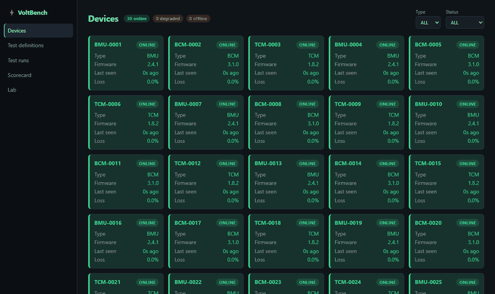
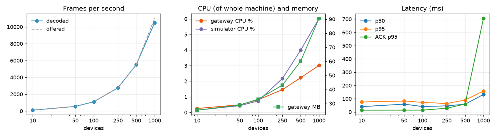

# VoltBench

A validation platform for simulated embedded controllers. It talks a binary protocol to hundreds of fake devices, runs automated test plans against them, catches faults in real time, and then checks its own work by comparing what it caught with what was actually broken.

There is no hardware in the loop. The devices are simulated, which is what makes it possible to know the ground truth and put real numbers on how well the validation works.



## What it does

Three kinds of low-voltage vehicle controller are simulated: a battery monitoring unit (BMU), a body control module (BCM) and a thermal control module (TCM). Each streams telemetry at 10 Hz, answers commands, and sends a heartbeat. A gateway connects to every device, decodes the frames, tracks health, stores the telemetry, and exposes everything over REST and WebSockets. A test runner executes YAML test plans against the devices and records a verdict for each test. A fault injector breaks devices in controlled ways. An evaluator then joins the test results against the injection log and reports how many faults were caught, how many alarms were false, and how long detection took.

The one rule that keeps the numbers honest: the gateway and the runner never see the fault injection records. Only the evaluator reads them, after the fact.

## How it fits together

```
                    React + Redux dashboard (browser)
                                |
                       REST  +  WebSocket
                                |
  Test runner ----REST----> Gateway (Go) ----> PostgreSQL
  (Python)                  decode, monitor     devices, tests, runs, results,
                            REST, WebSocket     alerts, scorecards
                                |        \----> MongoDB time-series (raw telemetry)
                         TCP binary protocol \--> /metrics for Prometheus
                                |
                     Device simulator (Python)  <---- Lab API: inject faults
                     N virtual controllers            |
                                                      v
  Evaluator <---------- ground truth ------- lab.fault_injections
```

| Part | Language | Role |
|---|---|---|
| [`simulator/`](simulator) | Python, asyncio | Virtual devices, the wire protocol, the lab API and fault injection |
| [`gateway/`](gateway) | Go | Frame decoding, health tracking, real-time monitor rules, REST and WebSocket APIs, metrics |
| [`runner/`](runner) | Python | The test language, the executor and the verdict logic |
| [`evaluator/`](evaluator) | Python | Reproducible campaigns, scoring, scorecards |
| [`web/`](web) | React, TypeScript, Redux Toolkit | Dashboard |
| [`deploy/`](deploy) | YAML, JSON | Prometheus rules and a provisioned Grafana dashboard |

## The simulator

Devices speak a CAN-inspired frame format over TCP: a sync byte, device id, message type, a 16-bit sequence number, a 48-bit timestamp, a length, up to 16 bytes of payload and a CRC-16. Values travel as fixed-point integers, the way firmware usually sends them. The full format is in [`docs/protocol.md`](docs/protocol.md).

Signals have noise, and the ones that react to commands follow a first-order lag. Switching on a BCM output pulls the load current toward 5 A with a time constant of 80 ms, evaluated analytically at each sample, so response-time tests measure something real.

Nine faults can be injected, each with a severity so detection can be plotted against how subtle the fault was:

| Fault | What happens |
|---|---|
| `drift` | The primary signal ramps away at a chosen rate in V/s |
| `stuck_value` | Signals freeze at their last value and the noise disappears |
| `out_of_range_spike` | Occasional samples jump far outside the hard limits |
| `packet_drop` | A percentage of frames is never sent |
| `crc_corruption` | A percentage of frames has a bit flipped |
| `latency_spike` | Acknowledgements are delayed |
| `hang` | The device stops responding entirely |
| `slow_response` | The response time constant is multiplied |
| `wrong_firmware` | The device reports an unexpected version |

## The gateway

One goroutine per device keeps a TCP connection open with exponential backoff, decodes the stream, checks every CRC, and counts missed frames from sequence-number gaps, including across the 16-bit wraparound. Status follows from what it sees: ONLINE, DEGRADED when loss or CRC errors show up in the last ten seconds, OFFLINE after two seconds of silence.

Telemetry goes to MongoDB in batches, flushed every 200 ms or 500 documents, never one insert per sample. The WebSocket feed is throttled to about ten updates a second per device and only sends signals that changed.

Five real-time rules run on the stream, independent of any scheduled test:

- **Hard limit:** three consecutive samples outside the hard limits.
- **Stale signal:** no frames for more than a second.
- **Rolling loss:** more than 2% of frames missing over a ten second window.
- **Stuck value:** rolling standard deviation over two seconds falls below a tenth of the expected noise.
- **CUSUM drift:** learns a baseline from the first thirty seconds, then accumulates deviations from it and alarms when the sum crosses a threshold.

Prometheus metrics are exposed at `/metrics`, and all services write structured JSON logs with a run and device id where one applies.

## The test runner

Tests are YAML, stored in PostgreSQL, validated against a pydantic schema before they are saved, and editable in the dashboard. An invalid file is rejected with line numbers, which the editor shows as inline errors.

```yaml
name: response_time_bcm
kind: response_time
device_type: BCM
version: 2
limits:
  max_rise_ms: 250
steps:
  - command: RESET
    expect_ack_within_ms: 1000
  - wait_online:
      timeout_ms: 3000
      record_as: boot_ms
  - command: SET_OUTPUT
    args: { channel: 1, state: on }
    expect_ack_within_ms: 500
  - measure:
      signal: load_current_a
      until: "value >= 0.9 * 5.0"
      timeout_ms: 600
      record_as: rise_time_ms
  - assert: "rise_time_ms <= max_rise_ms"
```

Assertions are small expressions that are parsed into an AST and checked against a whitelist, so a test definition cannot run arbitrary code. Eight kinds of check ship in [`runner/library`](runner/library): range, stability, spike, acknowledgement latency, response time, link quality, heartbeat recovery and firmware version. Devices run in parallel, tests run in order on each device, and a plan of nine tests takes about 30 seconds per device.

Every result is one of four verdicts:

- **PASS:** every assertion held.
- **FAIL:** the device behaved wrongly. A product problem.
- **ERROR:** the test could not run because the gateway failed or could not be reached. An infrastructure problem, never counted as a FAIL.
- **FLAKY:** failed, then passed on one automatic retry. Reported on its own instead of being hidden.

## The evaluator

A campaign is a reproducible experiment: a seed, a number of devices and a number of runs. In each run about 30% of the devices stay clean, which is what makes false alarms measurable, and every other device gets one random fault at a random severity. The full test plan runs, and the results are joined with the injection log.

A test result counts as an actual positive when a fault was active during the test window and its type is one the test is meant to catch. It counts as a predicted positive when the verdict is FAIL. ERROR results are left out of the scoring and reported separately. The catch list is in [`evaluator/metrics.py`](evaluator/metrics.py). Beyond the obvious pairings, a hung device is expected to fail every test, a frozen signal is expected to fail the response test as well as the stability test, and drift and spikes are expected to disturb the spread of a signal as well as its level.

Time to detect comes from the gateway's real-time rules: the gap between the fault starting and the first alert of a matching rule on that device. Latency, response time and firmware faults are invisible to the stream monitors by design, so they have no time to detect.

## Results

Two campaigns, both on 30 devices with the full nine-test plan. The first draws severities from the whole range of each fault, including the subtle end. The second skips the lower half of every range, which is the region where the tests are expected to work.

| Metric | Full range (12 runs, 252 faults) | Operating range (8 runs, 168 faults) | Target |
|---|---|---|---|
| Detection rate (recall) | 85.1% | 93.8% | 95% |
| Precision | 100% | 100% | 95% |
| False alarm rate | 0.0% | 0.0% | 2% |
| F1 | 92.0% | 96.8% | |
| Fault types caught at least once | 9 of 9 | 9 of 9 | 9 of 9 |
| Faulty devices with at least one FAIL | 88.5% | 95.8% | |
| Flaky rate | 0.18% | 0.11% | 1% |
| Infrastructure error rate | 0% | 0% | 0.5% |
| Real-time monitors: faults detected | 90.6% | 95.0% | |
| Real-time monitors: false alarms on clean devices | 0% | 0% | |
| Median time to detect | 1.5 s | 1.5 s | |

The detection target is missed in both. In the operating range the gap is entirely drift:

| Fault | Full range | Operating range |
|---|---|---|
| drift | 40% | 55% |
| stuck_value | 100% | 100% |
| out_of_range_spike | 93% | 100% |
| packet_drop | 96% | 100% |
| crc_corruption | 100% | 100% |
| latency_spike | 74% | 100% |
| hang | 100% | 100% |
| slow_response | 96% | 100% |
| wrong_firmware | 100% | 100% |

What the severity curves show:

- **Latency spikes below roughly 85 ms go unnoticed.** A healthy device acknowledges in about 12 ms and the limit is a 95th percentile of 100 ms, so a 30 ms delay does not fail the test. Everything above that is caught.
- **Slow response is caught almost everywhere,** with misses only at the mildest multiplier.
- **Drift is the weak spot for the scheduled tests.** The range check only fails once the mean of its five-second window leaves the nominal range. A battery cell has about 0.3 V of margin, so all but the slowest drifts leave the range during a run. The 13 V supply on the BCM and TCM has about 1.6 V of margin, which takes more than half a minute to cross at the fastest drift rate. The CUSUM monitor caught every drift in both campaigns, with a median of 1.4 seconds, including the slowest ones the tests never flagged.
- **Isolated spikes are hard for the monitors.** A single bad sample does not satisfy a rule that wants three in a row, so the monitors only caught the more frequent spikes. The five-second spike test, which looks at every sample, caught almost all of them.

The full per-test confusion matrices, severity buckets and time-to-detect histograms are in the scorecard page of the dashboard and in the generated [`docs/results/full-range.md`](docs/results/full-range.md) and [`docs/results/operating-range.md`](docs/results/operating-range.md), with the raw scorecards next to them as JSON.

## Scale

The platform was brought up at increasing fleet sizes with every device streaming at 10 Hz. Each step measures decoded frames per second, CPU and memory of the gateway and simulator, latency as seen by a WebSocket client (device timestamp to receipt), and command acknowledgement latency.



| Devices | Frames/s decoded | Gateway CPU | Gateway memory | Simulator CPU | Browser latency p50 / p95 / p99 | ACK p95 | Frames lost |
|---|---|---|---|---|---|---|---|
| 10 | 110 | 0.2% | 25 MB | 0.1% | 40 / 75 / 85 ms | 14 ms | 0 |
| 50 | 550 | 0.5% | 29 MB | 0.4% | 59 / 83 / 89 ms | 14 ms | 0 |
| 100 | 1,101 | 0.8% | 33 MB | 0.7% | 41 / 72 / 81 ms | 14 ms | 0 |
| 250 | 2,761 | 1.5% | 43 MB | 2.2% | 46 / 64 / 69 ms | 28 ms | 0 |
| 500 | 5,508 | 2.2% | 60 MB | 4.0% | 58 / 90 / 97 ms | 60 ms | 0 |
| 1000 | 10,488 | 3.0% | 91 MB | 6.0% | 132 / 158 / 168 ms | 705 ms | 0 |

CPU is a share of the whole machine, which has 16 hardware threads, so 6.0% is about one core. Percentiles use the nearest-rank method.

Nothing in the gateway is close to a limit at 500 devices: it decodes every offered frame, loses none, and uses 2% of the machine. The system breaks somewhere between 500 and 1000 devices, and what breaks is the simulator. It is one Python process with a single event loop, and at 1000 devices that loop is using a full core. Frames start arriving late, decoded throughput falls 5% short of what was offered, and command acknowledgements, which wait in the same loop, jump from 60 ms to 705 ms. MongoDB batch writes stayed in the 100 ms bucket for the 95th percentile at every size, and no WebSocket fan-out problem showed up, so neither is the bottleneck. Going further means running the fleet across several simulator processes, which the per-device port layout already allows.

The browser-side latency of 50 to 90 ms is consistent with the 100 ms per-device throttle on the WebSocket feed: an update waits half of that on average before it is sent.

## Design decisions

**Two databases.** Telemetry is a huge, append-only stream that is rarely updated, queried by device and time range, and expires after a week. A MongoDB time-series collection fits that and compresses it. Test definitions, runs and results need foreign keys, uniqueness on name and version, transactions and joins for reports, so they live in PostgreSQL.

**ERROR is not FAIL.** If the gateway is down, a FAIL would blame a perfectly good device and an ERROR would be the honest answer. The runner only reports FAIL when the gateway answered and the device did the wrong thing, including not answering at all. Gateway errors and timeouts become ERROR. A device that has stopped sending data entirely is a device failure, so a hung device fails every test it is given rather than hiding behind ERROR. The same split keeps the evaluator's error rate meaningful: it stayed at zero.

**Retries must start from the same state.** The first version of the response tests left the output switched on when an assertion failed, so the retry started at the target value, passed instantly, and the slow devices were reported as flaky instead of failing. Every attempt of those tests now begins with a reset and waits for the device to come back, and the detection rate for slow response went from 19% to 96%.

**CUSUM, and tuning it.** Plain range checks only notice drift after the signal has already left its limits. CUSUM accumulates small deviations from a learned baseline and notices a slow ramp within seconds. The starting parameters (k at half a sigma, h at five sigma) turned out to false-alarm on pure noise about once every 46 seconds per signal, which across five signals per device produced alarms constantly. A simulation in [`scripts/tune_cusum.py`](scripts/tune_cusum.py) swept k and h and measured both the time between false alarms and the delay on drifts of different rates, with the table in [`docs/cusum_tuning.md`](docs/cusum_tuning.md). The platform runs k = 0.75 and h = 10, which false-alarms about once in 300 hours per signal and still detects a 0.01 V/s drift in 1.3 seconds. Deviations are also clipped at four sigma so that one wild sample cannot trip the detector on its own. The monitors raised no false alarms on clean devices in either campaign.

**Commands and monitors have to agree.** Switching an output on is supposed to change a signal, and a monitor that alarms on it is just wrong. When the gateway sends a command that changes state, it quiets the drift and stuck rules for that device for a few seconds.

**Batching.** One Mongo insert per sample at 5,000 samples a second would be mostly round trips. The batch writer flushes on a timer or a size threshold, and drops samples instead of blocking the frame reader if it ever falls far behind. The WebSocket side does the equivalent for the browser: updates are throttled per device, only changed signals are sent, and the dashboard flushes live data at most once per animation frame into fixed-size ring buffers, so charts cannot grow without bound.

**Sequence numbers count what was sent, not what was built.** A device that drops a frame still consumed its sequence number, so loss shows up as a gap. A hung device builds nothing, so it creates no gap. A reboot starts the counter again and announces itself with a flagged heartbeat so the gateway does not read it as 500 lost frames.

## Testing

| Layer | What | Tool |
|---|---|---|
| Unit | Frame encoding against golden bytes, CRC reference vector, sequence wraparound, CUSUM behaviour, rolling windows, expression sandbox, YAML line errors, percentiles, metric formulas | Go `testing`, pytest |
| Property | `decode(encode(frame)) == frame` for random frames, any single bit flip fails the CRC, streams survive arbitrary read boundaries | hypothesis |
| Integration | A live stack: command to acknowledgement to stored telemetry, definition validation, an injected fault flagged by a test and by a monitor, CSV export | pytest |
| Frontend | Every verdict state, the ring buffer, latency percentiles | Vitest, Testing Library |
| End to end | Fleet overview and filter, live device page and command console, launching a run and opening a report, rejecting an invalid definition | Playwright |

Statement coverage of the Go gateway packages measured by unit tests alone: protocol 96%, monitor 79%, device manager 64%, WebSocket hub and helpers in the API package 14%, 36% overall. The HTTP handlers and the database code are exercised by the integration and end-to-end suites rather than by unit tests, and are not counted in that figure.

## Repository layout

```
simulator/    protocol, devices, faults, lab API
gateway/      decoder, monitors, REST and WebSocket, metrics
runner/       test language, executor, verdicts, library of tests
evaluator/    campaigns, scoring, scorecards
web/          dashboard and Playwright tests
spec/         device catalog shared by every service
db/           schema
deploy/       Prometheus rules, Grafana dashboard
scripts/      local process supervisor, CUSUM tuning, scale test
integration/  tests that run against a live stack
docs/         protocol, CUSUM tuning table, scale results, demo GIF
```

## Limits

Everything runs as local processes, including its own PostgreSQL and MongoDB instances, so nothing needs a container runtime. The Prometheus rules and the Grafana dashboard are written and provisioned from files but were not run against a Prometheus server here. The Jenkins pipeline and the GitHub Actions workflow are written to match the local commands. The simulator is a single Python process, which is the first thing to run out of room as the fleet grows.
